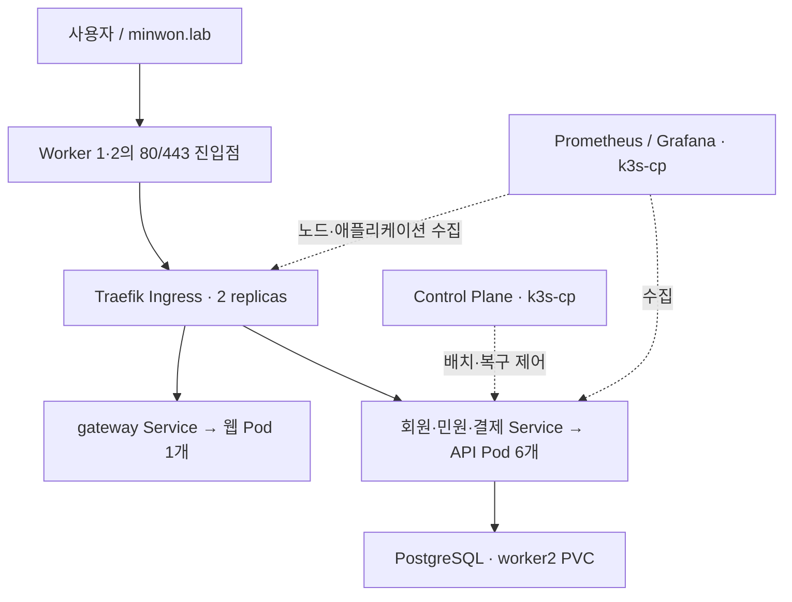

# EC2 3대 + K3s + Ingress 실습

기준: Ubuntu Server 24.04 LTS / x86_64. 이 문서의 기본 실습은 **Control Plane 1대 + Worker 2대**이다. 노드 3대가 모두 Control Plane인 etcd HA 구성과는 다르다. 실제 EC2 생성·배포는 사용자 AWS 계정에서 진행한다.

## 1. 배치와 장애 경계

| EC2 / Kubernetes 노드명 | 권장 실습 사양 | 역할 |
|---|---|---|
| k3s-cp | 4 vCPU / 8GiB / gp3 50GiB | API Server, Controller, Scheduler, SQLite, 모니터링, 배포 Runner |
| k3s-worker1 | 4 vCPU / 8GiB / gp3 40GiB | Java API, 웹사이트, Traefik |
| k3s-worker2 | 4 vCPU / 8GiB / gp3 60GiB | Java API, 웹사이트, Traefik, PostgreSQL/PVC |

권장값은 학습 구성에 대한 제안이며 공식 최소 요구사항이 아니다. 한 Worker에 API 6개가 모이는 복구 실습까지 고려하였다. 모니터링 보관 기간/요청량이 늘면 증설한다.

업무 Pod는 member-api 2 + order-api 2 + payment-api 2 + postgres 1 + gateway 1 = **8개**이다. gateway는 이름을 유지했지만 Kubernetes에서는 **정적 웹 화면만 제공**한다. API 라우팅은 Traefik Ingress가 직접 수행한다. Traefik 2개, ServiceLB 및 모니터링/시스템 Pod는 8개에 포함되지 않는다.

API는 `lab-role=worker`에만 배치하고 topology spread의 ScheduleAnyway로 두 Worker 분산을 우선한다. 복구 시 한 Worker에 모일 수 있다. 분산은 강제 보장이 아니므로 실제 `get pods -o wide` 결과를 확인한다. PostgreSQL은 local-path 데이터 때문에 worker2에 고정한다. 단일 웹 Pod는 노드 장애 후 새로 생성될 때까지 화면 중단이 발생할 수 있다.



Control Plane과 DB가 각각 한 개이므로 완전한 HA가 아니다. CP 중단 시 기존 컨테이너는 계속 동작할 수 있지만 스케줄링/자동 복구/배포를 기대할 수 없다. worker2 중단 시 DB가 함께 중단된다. 자동화된 외부 진입점 장애 전환은 선택 실습인 NLB가 담당하며, 단일 IP의 hosts 설정만으로는 자동 전환되지 않는다.

## 2. AWS 콘솔에서 EC2 3대 준비

1. 같은 VPC의 서로 통신 가능한 서브넷을 사용한다. 예: VPC 10.0.0.0/16. K3s 기본 Pod 10.42.0.0/16, Service 10.43.0.0/16과 겹치지 않아야 한다.
2. Ubuntu 24.04 x86_64 EC2 세 대를 생성하고 위 표처럼 Name을 정한다.
3. 첫 실습은 인터넷 게이트웨이와 퍼블릭 IPv4가 있는 퍼블릭 서브넷으로 단순화한다. 인바운드는 본인 IP로 제한한다. 운영 전환 시 Private Subnet/NAT·SSM 등으로 변경한다.
4. 세 인스턴스에 같은 전용 보안 그룹 `sg-k3s-lab`을 연결한다.
5. 다음 인바운드 규칙을 적용한다. 아웃바운드는 실습 기본 전체 허용이다.

| 프로토콜/포트 | 소스 | 용도 |
|---|---|---|
| TCP 22 | 내 공인 IP/32 | SSH |
| TCP 80, 443 | 내 공인 IP/32 | Ingress HTTP/HTTPS |
| 모든 트래픽 | **sg-k3s-lab 자기 자신** | 세 노드의 내부 통신·메트릭 수집 |

자기 자신을 소스로 한 규칙은 인터넷 전체 허용이 아니다. 학습 시 내부 통신 누락을 줄이기 위한 설정이다. 최소 포트로 줄일 때는 TCP 6443(Control Plane), UDP 8472(Flannel VXLAN), TCP 10250(kubelet), TCP 9100(node-exporter) 및 선택 기능의 통신을 검토한다. 8472와 6443을 0.0.0.0/0에 열지 않는다. 커스텀 NACL/OS 방화벽을 사용하면 반환 트래픽과 관련 포트도 확인한다.

6. 각 EC2의 **Private IP와 Public IP를 기록**한다. 아래 명령의 IP는 예시이므로 실제 값으로 바꾼다. EC2 중지/시작 후 Public IP가 바뀔 수 있으므로 hosts도 갱신한다.

모든 노드에 SSH로 접속해 준비한다.

```bash
sudo apt-get update
sudo apt-get install -y curl ca-certificates git jq openssl
uname -m
sudo ufw status
```

Ubuntu 기본 UFW 비활성 상태를 가정한다. 활성 상태라면 공식 K3s 요구 포트와 Pod/Service CIDR 통신을 허용해야 한다. 기존 운영 서버의 방화벽을 임의로 해제하지 않는다.

## 3. Control Plane 설치 — k3s-cp에서만

이 버전은 **새 EC2 세 대에 구축**한다. 이전 단일 노드 예제의 `--disable traefik --disable servicelb` 옵션을 사용하지 않는다.

```bash
read -rp 'Control Plane private IP: ' LAB_CP_IP
sudo install -d -m 755 /etc/rancher/k3s
sudo tee /etc/rancher/k3s/config.yaml >/dev/null <<EOF_CONFIG
node-name: k3s-cp
node-ip: "$LAB_CP_IP"
write-kubeconfig-mode: "0600"
EOF_CONFIG
curl -sfL https://get.k3s.io -o /tmp/install-k3s.sh
sudo sh /tmp/install-k3s.sh server
sudo systemctl status k3s --no-pager
mkdir -p "$HOME/.kube"
sudo cp /etc/rancher/k3s/k3s.yaml "$HOME/.kube/config"
sudo chown "$(id -u):$(id -g)" "$HOME/.kube/config"
chmod 600 "$HOME/.kube/config"
export KUBECONFIG="$HOME/.kube/config"
printf '\nexport KUBECONFIG="$HOME/.kube/config"\n' >> "$HOME/.bashrc"
kubectl config rename-context default citizen-lab
kubectl config use-context citizen-lab
kubectl get nodes
sudo k3s --version
sudo cat /var/lib/rancher/k3s/server/node-token
```

버전 출력의 `v...+k3s...` 값과 node-token을 안전하게 기록한다. 토큰은 Worker 가입용 비밀정보이다. Git/스크린샷에 올리지 않는다. CP 최초 설치는 설치일 stable 버전이며, Worker는 CP와 동일한 버전을 지정한다.

## 4. Worker 가입 — worker1과 worker2 각각에서

worker1에서는 노드명 `k3s-worker1`, worker2에서는 `k3s-worker2`를 입력한다.

```bash
read -rp 'Node name (k3s-worker1 or k3s-worker2): ' LAB_NODE
read -rp 'This worker private IP: ' LAB_NODE_IP
read -rp 'Control Plane private IP: ' LAB_CP_IP
read -rp 'Exact K3s version from CP: ' LAB_K3S_VERSION
read -rsp 'Join token: ' LAB_JOIN_TOKEN
printf '\n'
sudo install -d -m 755 /etc/rancher/k3s
sudo install -m 600 /dev/null /etc/rancher/k3s/config.yaml
sudo tee /etc/rancher/k3s/config.yaml >/dev/null <<EOF_CONFIG
server: "https://$LAB_CP_IP:6443"
token: "$LAB_JOIN_TOKEN"
node-name: "$LAB_NODE"
node-ip: "$LAB_NODE_IP"
EOF_CONFIG
unset LAB_JOIN_TOKEN
curl -sfL https://get.k3s.io -o /tmp/install-k3s.sh
sudo env INSTALL_K3S_VERSION="$LAB_K3S_VERSION" sh /tmp/install-k3s.sh agent
sudo systemctl status k3s-agent --no-pager
```

CP에서 다음을 실행한다.

```bash
kubectl get nodes -o wide
kubectl wait --for=condition=Ready node/k3s-cp node/k3s-worker1 node/k3s-worker2 --timeout=180s
```

Worker의 ROLES가 `<none>`이어도 정상일 수 있다. `lab-role`은 이후에 별도로 붙이는 학습용 라벨이다.

## 5. 소스와 Traefik 구성 — CP에서

README대로 소스를 Private GitHub 저장소에 올린 뒤 clone한다.

```bash
git clone https://github.com/YOUR_OWNER/citizen-portal-lab.git
cd citizen-portal-lab
bash scripts/label-nodes.sh
kubectl apply -f infra/traefik-config.yaml
kubectl -n kube-system rollout status deployment/traefik --timeout=300s
kubectl -n kube-system get deploy traefik
kubectl -n kube-system get pods -l app.kubernetes.io/name=traefik -o wide
kubectl -n kube-system get svc traefik
kubectl -n kube-system get daemonsets
kubectl get ingressclass
```

HelmChartConfig 반영은 비동기이다. Deployment replicas=2, Worker별 Traefik 분산, ServiceLB가 Worker 두 곳에서 실행되는지 확인한다. 아직 이전 Pod가 보이면 잠시 후 다시 조회한다. CP에는 ServiceLB allow-list 라벨을 부여하지 않는다. HelmChartConfig가 K3s의 기본 Traefik chart 설정을 확장한다. 기본 `/var/lib/rancher/k3s/server/manifests/traefik.yaml`을 직접 수정하지 않는다.

K3s의 ServiceLB는 AWS ELB를 자동으로 생성하지 않는다. 각 Worker 호스트의 80/443을 사용하여 Traefik Service로 전달한다. `EXTERNAL-IP`에 Private IP만 보여도 EC2의 Public IP NAT와 보안 그룹 설정이 올바르면 외부에서 접근할 수 있다. 여기에 별도 host nginx/apache를 설치하여 80/443을 점유하지 않는다.

## 6. 이미지와 Secret 준비

GitHub main push 후 test/build 성공을 확인한다. 두 이미지의 동일 SHA 태그를 기록한다. 이번 버전의 화면 이미지는 **web/Dockerfile.ingress**로 빌드한다. GitHub workflow는 이를 반영하였다. 로컬 Compose는 기존 web/Dockerfile의 프록시 모드를 유지한다.

```bash
kubectl apply -f k8s/namespace.yaml
read -rsp 'DB password: ' LAB_DB_PASSWORD
printf '\n'
kubectl -n shop create secret generic db-secret --from-literal=password="$LAB_DB_PASSWORD"
unset LAB_DB_PASSWORD
read -rp 'GitHub username: ' LAB_GH_USER
read -rsp 'GHCR read:packages token: ' LAB_GH_TOKEN
printf '\n'
kubectl -n shop create secret docker-registry ghcr-pull \
 --docker-server=ghcr.io --docker-username="$LAB_GH_USER" \
 --docker-password="$LAB_GH_TOKEN"
unset LAB_GH_TOKEN
export IMAGE='ghcr.io/joo-pe/citizen-portal-lab:FULL_COMMIT_SHA'
export WEB_IMAGE='ghcr.io/joo-pe/citizen-portal-lab-web:FULL_COMMIT_SHA'
bash scripts/bootstrap.sh
```

DB PVC가 최초 생성되는 시점에 worker2를 선택한다. **이전 단일 노드의 PVC를 그대로 가져와 nodeSelector만 바꾸면 볼륨의 node affinity 때문에 Pending이 된다.** 이전 실습 데이터는 pg_dump로 백업하고 새 클러스터의 새 PVC에 pg_restore한다. 이 가이드는 기존 클러스터 자동 전환 스크립트가 아니다.

```bash
kubectl -n shop get pods -o wide
kubectl -n shop get pods --no-headers | wc -l
kubectl -n shop get ingress,svc,pvc,pdb
kubectl get pv
```

정상 안정 상태 업무 Pod는 8개이다. 배포 중 임시 Pod와 장애 실습용 Pod는 별도이다.

## 7. Ingress 접속과 라우팅 확인

기본 host는 `minwon.lab`이며 실제 공인 도메인을 구매할 필요는 없다.

**PC의 hosts 파일**을 관리자 권한으로 수정한다.

- Windows: `C:\Windows\System32\drivers\etc\hosts`
- macOS/Linux: `/etc/hosts`

```text
WORKER1_PUBLIC_IP minwon.lab
```

실제 IP로 바꾼 후 브라우저에서 **http://minwon.lab**에 접속한다. 기존 30080은 사용하지 않는다. IP 주소만 브라우저에 입력하면 Host 규칙이 맞지 않아 Traefik 404가 나타날 수 있다.

명령으로는 hosts 수정 없이 확인할 수 있다. PC에서는 Public IP, CP에서는 Worker Private IP를 사용한다.

```bash
export INGRESS_IP='WORKER1_PRIVATE_IP'
bash scripts/smoke-ingress.sh
export INGRESS_IP='WORKER2_PRIVATE_IP'
bash scripts/smoke-ingress.sh
curl -i --resolve minwon.lab:80:$INGRESS_IP http://minwon.lab/api/orders
```

마지막 요청은 인증을 넣지 않았으므로 **401이 정상**이다. 홈페이지 200과 API 401을 구분하여 Ingress가 실제 API에 도달했는지 확인한다.

| 경로 | Ingress backend | 포트 |
|---|---|---:|
| /api/members | member-api | 8080 |
| /api/orders | order-api | 8080 |
| /api/payments | payment-api | 8080 |
| / | gateway | 80 |

Prefix 경로를 제거하지 않으므로 Java Controller 경로와 일치한다. 더 구체적인 API 경로가 `/`보다 우선한다. 애플리케이션 Service는 모두 ClusterIP이다.

## 8. HTTPS 선택 실습

CP의 저장소 루트에서 자기서명 인증서를 만든다. 인증서를 PC에 신뢰 등록하지 않으면 브라우저 경고가 나타나는 학습용 TLS이다. HTTP 실습과 별도의 Ingress 리소스를 생성한다.

```bash
mkdir -p .local-tls
openssl req -x509 -nodes -newkey rsa:2048 -days 7 \
 -keyout .local-tls/tls.key -out .local-tls/tls.crt \
 -subj '/CN=minwon.lab' -addext 'subjectAltName=DNS:minwon.lab'
kubectl -n shop create secret tls minwon-tls \
 --key=.local-tls/tls.key --cert=.local-tls/tls.crt
kubectl apply -f k8s/ingress-tls.yaml
curl --cacert .local-tls/tls.crt --resolve minwon.lab:443:$INGRESS_IP https://minwon.lab/
```

인증서/키는 Git에 올리지 않는다. `.local-tls/`는 .gitignore에 포함되어 있다. 예제는 HTTP를 HTTPS로 자동 리다이렉트하지 않는다. 실제 공개 서비스는 실제 도메인, 신뢰된 인증서, 리다이렉트 정책으로 전환한다.

## 9. GitHub Runner / 자동 배포 — CP에 설치

```bash
sudo useradd --create-home --shell /bin/bash runner
bash scripts/runner-credentials.sh
sudo -iu runner
mkdir -p actions-runner
cd actions-runner
```

GitHub Settings → Actions → Runners → New self-hosted runner → Linux/x64의 다운로드·config 명령을 실행한다. label에 **shop-lab**을 넣는다. 이미 존재하는 사용자/Runner는 중복 생성하지 않는다.

```bash
exit
cd /home/runner/actions-runner
sudo ./svc.sh install runner
sudo ./svc.sh start
sudo ./svc.sh status
cd "$HOME/citizen-portal-lab"
```

GitHub Settings → Secrets and variables → Actions → Variables에 `ENABLE_DEPLOY=true`를 등록한다. main push 후 API 세 개와 웹 Deployment의 이미지가 갱신된다. **Ingress/PDB/클러스터/모니터링 설정 변경은 관리자 kubectl apply로 반영**한다. CI Runner는 이미지 갱신 권한만 있다.

배포 토큰은 24시간 수명을 요청한다. 만료되면 CP 관리자 계정으로 `bash scripts/runner-credentials.sh`를 실행한다. Runner를 Worker에 설치하면 kubeconfig의 127.0.0.1:6443에 API Server가 없으므로 이 가이드대로 CP에 설치한다.

장애 실습 중 자동 배포가 복구 설정을 덮어쓰지 않도록 ENABLE_DEPLOY=false로 잠시 바꾸고 종료 후 true로 복원한다.

## 10. 모니터링 및 장애 실습

1. [MONITORING.md](MONITORING.md)대로 설치한다. 전용 Grafana 대시보드 16개 패널과 알림 규칙을 포함했다.
2. [FAILURE-LABS.md](FAILURE-LABS.md)의 공통 준비를 수행한다.
3. 한 번에 한 가지 장애만 만들고 복구한 뒤 다음 실습으로 넘어간다.

## 11. 외부 진입점 자동 전환 — 선택 NLB 실습

hosts에 Worker1 IP만 넣으면 Worker1 중단 시 Worker2로 자동 접속하지 않는다. 자동 진입점 전환을 관찰하려면 별도 비용이 드는 AWS NLB를 추가한다.

1. EC2 콘솔 → 대상 그룹 생성 → 대상 유형 Instances → TCP 80. Worker1/Worker2를 등록한다.
2. 헬스체크는 TCP / traffic port. 학습 기본으로 노드의 Ingress 진입 포트 생존 여부를 검사한다. 이 검사만으로 민원/DB 정상 여부를 판단하지 않는다.
3. Load Balancers → Network Load Balancer 생성 → Internet-facing → IPv4 → Worker가 있는 AZ/서브넷 선택. 가능하면 두 AZ에 Worker를 분산한다.
4. NLB 생성 시 전용 SG를 연결한다. NLB SG 인바운드는 TCP80을 내 IP/32에서 허용하고, Worker SG는 NLB SG에서 TCP80 및 헬스체크 접근을 허용한다.
5. Listener TCP80 → 위 대상 그룹. cross-zone load balancing을 활성화하고 Target health가 두 개 모두 healthy인지 확인한다.
6. CLI 확인: `curl -H 'Host: minwon.lab' http://NLB_DNS_NAME/`.
7. 실제 소유 도메인이 있다면 두 Ingress 파일의 host를 그 도메인으로 바꾸고 적용한 뒤 Route53 Alias 또는 적절한 DNS 레코드를 NLB로 연결한다. NLB DNS의 변동 IP를 hosts에 고정하지 않는다.

TLS 실습에서는 TCP443 대상 그룹/Listener를 추가하고 TLS는 Traefik에서 종료할 수 있다. NLB는 이 프로젝트의 `Service type=LoadBalancer`가 자동 생성하는 리소스가 아니며 별도로 생성/삭제해야 한다. NLB 자체를 추가해도 단일 PostgreSQL과 단일 CP의 장애까지 해결되지는 않는다.

## 12. 종료 및 운영 확장

백업 확인 후 실습용 클러스터에서만 수행한다. namespace 삭제는 PVC 삭제와 데이터 손실을 동반한다.

```bash
kubectl delete namespace lab-faults --ignore-not-found
helm uninstall monitor -n monitoring
kubectl delete namespace monitoring
kubectl delete namespace shop
```

Runner 서비스 중지/제거, GitHub Runner 등록 제거, PAT 폐기를 수행한다. AWS 콘솔에서 NLB/Target Group, EC2, 잔여 EBS/EIP/스냅샷 등 유료 자원을 확인한다. 단순 EC2 Stop은 EBS/NLB 등의 요금을 없애지 않는다.

운영 HA가 목표라면 CP 3대(embedded etcd quorum) 또는 EKS, RDS/DB HA, 웹 2개 이상, NLB/ALB 등의 설계가 추가로 필요하다. 웹을 2개로 늘리면 현재 업무 Pod 8개 조건은 변경된다.

공식 근거:
- https://docs.k3s.io/quick-start
- https://docs.k3s.io/installation/requirements
- https://docs.k3s.io/networking/networking-services
- https://docs.k3s.io/datastore/ha-embedded
- https://kubernetes.io/docs/concepts/services-networking/ingress/
